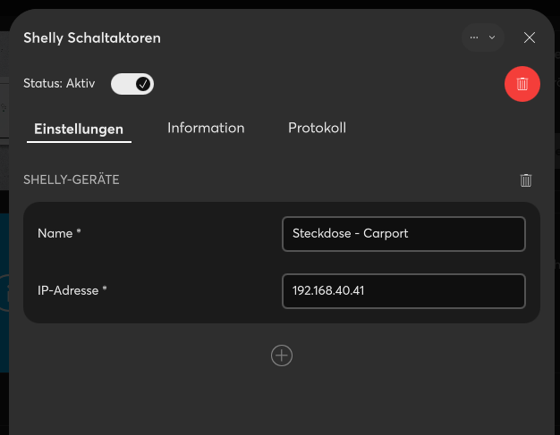

# free@home Add-On: Shelly Schaltaktoren

**Deutsch** · [English](#english)

Bindet Shelly-Relais und -Steckdosen als virtuelle **Schaltaktoren** in
ABB/Busch-Jaeger free@home ein (System Access Point 2.0 mit Add-On-Unterstützung).

- Ein/Aus aus free@home (App, Taster, Szenen, Zeitprogramme)
- Generation und Anzahl der Relais werden automatisch erkannt; pro Relais-Kanal entsteht ein Schaltaktor
- Rückmeldung, wenn der Shelly anders geschaltet wird (Eingang, Shelly-App, Web-UI)
- Shelly nicht erreichbar → Gerät erscheint als „nicht erreichbar“, automatischer Reconnect
- Rein lokal über die Shelly-HTTP/RPC-API, kein Cloud-Zugriff

## Unterstützte Geräte

| Shelly | Beispiele | Rückmeldung |
|---|---|---|
| Gen2, Gen3, Gen4 (Plus, Pro, Mini) | Pro 1PM, Pro 4PM, Plus 1, Plus Plug S, 1PM Gen3, Plug S Gen3 | sofort (WebSocket) |
| Gen1 | Shelly 1, 1PM, 2.5, Plug, Plug S | alle 5 s (Polling) |

Nicht unterstützt: Rollladen-/Cover-Modus, Dimmer, RGBW, reine Sensoren und
Shellys mit aktiviertem Passwortschutz. Getestet am echten Gerät wurde bisher der Shelly Pro 1PM;
die übrigen Modelle nutzen dieselbe dokumentierte Shelly-API.

## Voraussetzungen

- Shelly im selben Netz wie der SysAP, **feste IP** (DHCP-Reservierung empfohlen), **ohne** Passwortschutz
- SysAP mit Add-On-Unterstützung und aktiviertem Entwicklermodus (zum Hochladen eigener Add-Ons)
- Für die Entwicklung: Node.js ≥ 20

## Bauen

```bash
npm install
```

```bash
npm run pack
```

Ergebnis: `de.julian-gilles.shelly-switch-2.1.0.tar` – diese Datei im SysAP-Webinterface
unter Add-Ons hochladen und installieren.

## Konfiguration

Die Shellys werden im SysAP-Webinterface in den Einstellungen des Add-Ons
„Shelly Schaltaktoren“ eingetragen (Reiter **Einstellungen**, Bereich **Shelly-Geräte**):



| Feld       | Bedeutung                                              | Beispiel           |
|------------|--------------------------------------------------------|--------------------|
| Name       | Name des Schaltaktors in free@home                     | Steckdose - Carport |
| IP-Adresse | Feste IP-Adresse des Shelly im lokalen Netz            | 192.168.40.41      |
| Bei Nichterreichbarkeit melden | Ist der Shelly nicht erreichbar, zeigt free@home „Gerät nicht erreichbar“. Ausschalten, um diese Meldung zu unterdrücken (z. B. bei Steckdosen, die oft ausgesteckt sind). Standard: an | an |

Bei ausgeschalteter Meldung bleibt der Schaltaktor in free@home scheinbar erreichbar; Schaltbefehle an
einen nicht erreichbaren Shelly gehen dann ins Leere und der alte Zustand wird zurückgemeldet.
Beim Neustart oder Update des Add-Ons markiert free@home die Geräte kurz als nicht erreichbar.

- **⊕ (Plus unter der Liste):** fügt einen weiteren Shelly hinzu. Für jeden Shelly einen eigenen
  Eintrag mit Name und IP-Adresse anlegen; Shellys mit mehreren Relais brauchen trotzdem nur einen Eintrag.
- **Papierkorb rechts neben „Shelly-Geräte“:** entfernt diesen Eintrag.
- **Protokoll:** zeigt die Log-Ausgaben des Add-Ons, z. B. „detected … (Gen2), 1 relay channel(s)“
  oder warum ein Shelly nicht verbunden werden konnte.

Nach dem Speichern erscheint pro Relais ein neuer Schaltaktor in free@home, der wie ein normales
Gerät einem Raum zugeordnet und mit Tastern verknüpft werden kann.

Hat ein Shelly mehrere Relais (z. B. Pro 4PM), entstehen automatisch mehrere Schaltaktoren
mit durchnummerierten Namen („Gartenpumpe 1“, „Gartenpumpe 2“ …).

Wird ein Eintrag gelöscht, markiert das Add-On die Geräte nur als „nicht erreichbar“;
die Geräte selbst müssen in free@home bei Bedarf manuell entfernt werden.

### Umstieg von Version 1 (`de.julian-gilles.shelly-pro-1pm`)

Version 2 hat eine neue Add-On-ID. Alte Version im SysAP deinstallieren, neue installieren,
Shellys neu eintragen und die neuen Schaltaktoren in free@home Räumen und Tastern zuordnen.

## Shelly ohne free@home testen

```bash
npm run test:shelly -- 192.168.1.50 on
```

Optional mit Kanal: `npm run test:shelly -- 192.168.1.50 on 1`. Ohne `on`/`off` bleibt das
Skript verbunden und zeigt Statusänderungen live an.

## Lokal gegen den SysAP laufen lassen (Entwicklung)

```bash
FREEATHOME_BASE_URL=http://<sysap-ip> FREEATHOME_API_USERNAME=<user> FREEATHOME_API_PASSWORD=<passwort> npm start
```

## Aufbau

- `src/shelly/index.ts` – erkennt Generation und Relais-Kanäle (`GET /shelly`) und wählt den Client
- `src/shelly/gen2.ts` – Gen2+: RPC `Switch.Set`/`Shelly.GetStatus`, WebSocket `NotifyStatus`, 30-s-Polling als Fallback
- `src/shelly/gen1.ts` – Gen1: `/relay/<n>?turn=on|off`, `/status`-Polling
- `src/bridge.ts` – verknüpft einen Shelly mit je einem free@home-Schaltaktor pro Kanal
- `src/main.ts` – liest die Add-On-Konfiguration und verwaltet die Geräte
- `free-at-home-metadata.json` – Add-On-Metadaten und Konfigurationsparameter

---

## English

free@home add-on that exposes Shelly relays and smart plugs as virtual **switch actuators** in
ABB/Busch-Jaeger free@home (System Access Point 2.0 with add-on support).

- Switch on/off from free@home (app, wall switches, scenes, timers)
- Shelly generation and number of relays are detected automatically; one switch actuator per relay channel
- State feedback when the Shelly is switched elsewhere (input, Shelly app, web UI)
- Shelly unreachable → device shows as "unresponsive" in free@home, automatic reconnect
- Local only via the Shelly HTTP/RPC API, no cloud access

### Supported devices

| Shelly | Examples | Feedback |
|---|---|---|
| Gen2, Gen3, Gen4 (Plus, Pro, Mini) | Pro 1PM, Pro 4PM, Plus 1, Plus Plug S, 1PM Gen3, Plug S Gen3 | instant (WebSocket) |
| Gen1 | Shelly 1, 1PM, 2.5, Plug, Plug S | every 5 s (polling) |

Not supported: roller/cover mode, dimmers, RGBW, sensors and Shellys with password protection
enabled. So far only the Shelly Pro 1PM has been tested on real hardware; the other models use
the same documented Shelly API.

### Requirements

- Shelly on the same network as the SysAP, with a **fixed IP** (DHCP reservation recommended) and **no** password
- SysAP with add-on support and developer mode enabled (to upload custom add-ons)
- For development: Node.js ≥ 20

### Build and install

```bash
npm install
```

```bash
npm run pack
```

This creates `de.julian-gilles.shelly-switch-2.1.0.tar`. Upload and install it in the SysAP
web interface under add-ons.

### Configuration

Add your Shellys in the SysAP web interface in the settings of the add-on
"Shelly Switch Actuators" (tab **Settings**, section **Shelly devices**; see the screenshot above,
taken from a German SysAP).

| Field      | Meaning                                        | Example            |
|------------|------------------------------------------------|--------------------|
| Name       | Name of the switch actuator in free@home       | Garden pump        |
| IP address | Fixed IP address of the Shelly on your network | 192.168.1.50       |
| Report when unreachable | If the Shelly cannot be reached, free@home shows "device not reachable". Turn off to suppress this message (e.g. for plugs that are often unplugged). Default: on | on |

With reporting turned off, the actuator stays "reachable" in free@home; commands to an unreachable
Shelly have no effect and the previous state is reported back. While the add-on restarts or is
updated, free@home briefly marks the devices as unreachable.

- **⊕ (plus below the list):** adds another Shelly. Create one entry per Shelly; a Shelly with
  several relays still needs only one entry.
- **Trash icon next to "Shelly devices":** removes this entry.
- **Log tab:** shows the add-on's log output, e.g. "detected … (Gen2), 1 relay channel(s)" or why
  a Shelly could not be connected.

After saving, one switch actuator per relay appears in free@home and can be assigned to a room and
linked to wall switches like any other device. Shellys with several relays (e.g. Pro 4PM) get
numbered names ("Garden pump 1", "Garden pump 2" …).

Deleting an entry only marks its devices as unresponsive; remove the devices in free@home
manually if no longer needed.

### Upgrading from version 1 (`de.julian-gilles.shelly-pro-1pm`)

Version 2 has a new add-on ID. Uninstall the old version on the SysAP, install the new one,
add your Shellys again and assign the new switch actuators to rooms and wall switches.

### Testing a Shelly without free@home

```bash
npm run test:shelly -- 192.168.1.50 on
```

Optionally with a channel: `npm run test:shelly -- 192.168.1.50 on 1`. Without `on`/`off` the
script stays connected and prints state changes live.

---

## Lizenz / License

[MIT](LICENSE) © 2026 Julian Gilles
